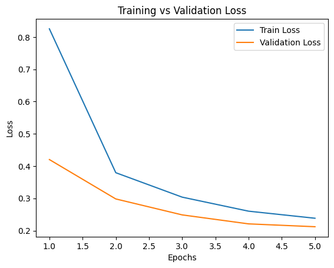
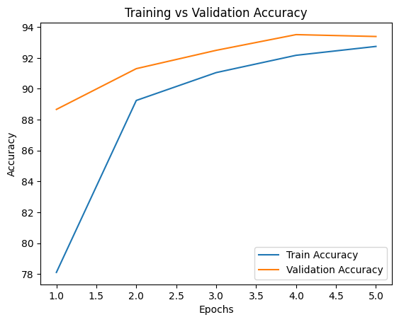
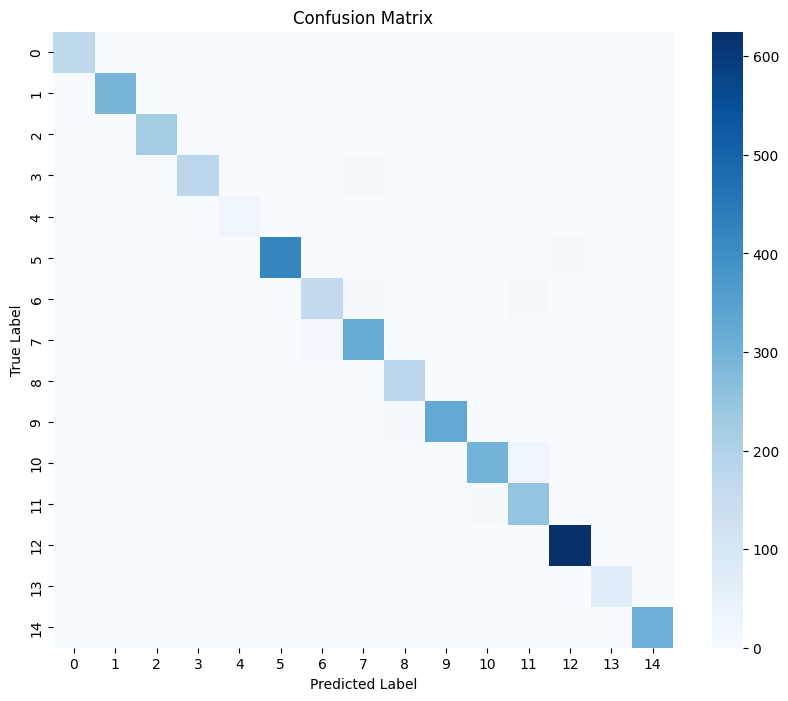

# 🌿 Plant Disease Detection using Deep Learning (ResNet-18)

[](https://www.python.org/)
[](https://pytorch.org/)
[](https://pytorch.org/vision/main/models/resnet.html)
[]()
[]()
[](LICENSE)

An end-to-end Deep Learning computer vision system for automated plant leaf disease diagnosis using **Transfer Learning with ResNet-18**. Trained and evaluated on the **PlantVillage** dataset across 15 agricultural disease and healthy foliage classes.

---

## 📌 Project Overview

Plant diseases represent one of the leading threats to global agricultural productivity, causing substantial crop yield loss and economic damage. Traditional visual inspection by agronomists is labor-intensive, slow, and inaccessible to smallholder farmers.

This project delivers an automated, high-precision visual diagnostic system that:
1. Employs a **ResNet-18 Convolutional Neural Network** pretrained on ImageNet to extract spatial features (lesions, discoloration, fungal patterns).
2. Classifies leaf photographs into **15 distinct crop disease categories** with **93.39% validation accuracy**.
3. Provides a **modular Python codebase (`src/`)**, reproducible **Jupyter Notebooks**, command-line inference tools, and a built-in **interactive web application (`app.py`)**.

---

## 🌟 Key Highlights

- **Pretrained Transfer Learning**: Leverages pretrained ResNet-18 weights to converge rapidly with superior feature generalization.
- **High Diagnostic Accuracy**: Achieved **93.39% validation accuracy** and a **0.93 macro F1-score** across 4,128 validation images.
- **15 Disease & Healthy Classes**: Covers critical crop species including Tomato, Potato, and Pepper Bell.
- **Built-in Interactive Web App**: Instant browser-based leaf upload, disease prediction with confidence bars, and treatment recommendations (`python app.py`).
- **Complete CLI Toolkit**: Modular scripts for training (`train.py`), model evaluation (`evaluate.py`), and single-image diagnosis (`predict.py`).
- **Data Augmentation Pipeline**: Flips, affine rotations, and color jittering to guard against overfitting.

---

## 🏗️ Model Architecture

The model uses **ResNet-18** (Residual Networks) as the feature extraction backbone:

```
Input Image (3 x 224 x 224)
        │
        ▼
7x7 Conv, 64 filters, stride 2 + MaxPool
        │
        ▼
[ResBlock 1]  -> 64 feature maps (skip connections)
        │
        ▼
[ResBlock 2]  -> 128 feature maps (skip connections)
        │
        ▼
[ResBlock 3]  -> 256 feature maps (skip connections)
        │
        ▼
[ResBlock 4]  -> 512 feature maps (skip connections)
        │
        ▼
Adaptive Average Pooling (512 x 1 x 1)
        │
        ▼
Dropout (p = 0.2)
        │
        ▼
Linear Layer (512 -> 15 Classes) + Softmax
```

### Why ResNet-18?
- **Residual Skip Connections**: Prevent vanishing/exploding gradients, allowing efficient backpropagation.
- **Pretrained Weights**: ImageNet filters already recognize lower-level textures, edges, and gradients that closely mirror leaf vein structures and lesion spots.
- **Computational Efficiency**: Lightweight footprint (~11.18 million parameters) suitable for real-time edge and mobile deployments.

---

## 📊 Experimental Results & Performance

The model was trained for 5 epochs using the **Adam optimizer** ($\text{lr} = 0.001$) and **Cross-Entropy Loss**:

| Epoch | Train Loss | Train Accuracy | Validation Loss | Validation Accuracy |
|:-----:|:----------:|:--------------:|:---------------:|:-------------------:|
|   1   |   0.8254   |     78.10%     |     0.4203      |       88.66%        |
|   2   |   0.3795   |     89.24%     |     0.2982      |       91.30%        |
|   3   |   0.3037   |     91.05%     |     0.2487      |       92.49%        |
|   4   |   0.2602   |     92.17%     |     0.2209      |       93.51%        |
|   5   |   0.2383   |     92.74%     |     0.2121      |     **93.39%**      |

### Training Curves
| Loss Curve | Accuracy Curve |
|:---:|:---:|
|  |  |

### Confusion Matrix
Evaluation over the 4,128 validation samples demonstrates high diagonal concentration and minimal inter-class confusion:

<p align="center">
  
</p>

### Classification Metrics (Summary)
- **Overall Accuracy**: **93.39%**
- **Macro Average Precision**: **0.93**
- **Macro Average Recall**: **0.93**
- **Macro Average F1-Score**: **0.93**
- **Total Test Samples**: 4,128 images

---

## 🌿 Target Crop Disease Classes

The model classifies 15 distinct classes across 3 major agricultural crops:

1. **Pepper Bell**: Bacterial Spot
2. **Pepper Bell**: Healthy
3. **Potato**: Early Blight
4. **Potato**: Late Blight
5. **Potato**: Healthy
6. **Tomato**: Bacterial Spot
7. **Tomato**: Early Blight
8. **Tomato**: Late Blight
9. **Tomato**: Leaf Mold
10. **Tomato**: Septoria Leaf Spot
11. **Tomato**: Spider Mites (Two-spotted spider mite)
12. **Tomato**: Target Spot
13. **Tomato**: Yellow Leaf Curl Virus
14. **Tomato**: Mosaic Virus
15. **Tomato**: Healthy

---

## 📁 Repository Structure

```
Plant_disease_detection/
├── assets/                          # Generated plots and evaluation figures
│   ├── confusion_matrix.png
│   ├── training_accuracy.png
│   └── training_loss.png
├── models/                          # Model checkpoints directory
│   └── .gitkeep
├── notebooks/                       # Jupyter notebooks
│   └── Plant_Disease_Detection_ResNet18.ipynb
├── src/                             # Modular Python package
│   ├── __init__.py
│   ├── config.py                    # Hyperparameters & path configuration
│   ├── dataset.py                   # Data loaders, augmentation, & dataset analysis
│   ├── model.py                     # ResNet-18 Transfer Learning architecture
│   ├── trainer.py                   # Training & validation loop orchestrator
│   └── utils.py                     # Metrics, plotting, and inference helpers
├── app.py                           # Interactive Web Application (zero external web deps)
├── evaluate.py                      # CLI evaluation script
├── predict.py                       # Single image inference script
├── train.py                         # CLI training script
├── Pretrained_CNN.ipynb             # Original submission notebook
├── requirements.txt                 # Python dependencies
├── .gitignore                       # Git ignore rules
├── LICENSE                          # MIT License
└── README.md                        # Documentation
```

---

## 🚀 Quick Start Guide

### 1. Clone the Repository
```bash
git clone https://github.com/aditya-121105/Plant_disease_detection.git
cd Plant_disease_detection
```

### 2. Set Up Environment
```bash
# Optional: Create virtual environment
python3 -m venv venv
source venv/bin/activate  # On Windows: venv\Scripts\activate

# Install dependencies
pip install -r requirements.txt
```

---

## 💻 Usage Instructions

### 1. Launch the Interactive Web App
Start the zero-dependency web interface:
```bash
python app.py --port 8000
```
Open [http://localhost:8000](http://localhost:8000) in your browser. Drag and drop any leaf photograph to obtain instant diagnosis and agricultural treatment recommendations.

### 2. Predict on a Single Image (CLI)
```bash
python predict.py --image path/to/leaf_photo.jpg --top_k 3
```

**Example Output:**
```
=======================================================
        PLANT DISEASE DIAGNOSIS RESULTS
=======================================================
 1. Tomato - Early blight                     94.62%  ⚠️  [DISEASE DETECTED]
 2. Tomato - Target spot                       3.81%  ⚠️  [DISEASE DETECTED]
 3. Tomato - Septoria leaf spot                1.15%  ⚠️  [DISEASE DETECTED]
=======================================================

⚠️  Diagnosis: High likelihood of Tomato - Early blight (94.6% confidence).
💡 Recommendation: Ensure adequate plant spacing for airflow; mulch around the base; prune lower infected foliage.
```

### 3. Train the Model
```bash
python train.py --data_dir PlantVillage --epochs 5 --batch_size 32 --lr 0.001
```

### 4. Evaluate Checkpoint
```bash
python evaluate.py --data_dir PlantVillage --model_path models/plant_disease_resnet18.pth
```

### 5. Run the Jupyter Notebook
```bash
jupyter notebook notebooks/Plant_Disease_Detection_ResNet18.ipynb
```

---

## 🛠️ Tech Stack & Tools

- **Core Framework**: [PyTorch](https://pytorch.org/) & [Torchvision](https://pytorch.org/vision/)
- **Architecture**: Pretrained ResNet-18 (Deep Residual Learning for Image Recognition)
- **Data Science**: NumPy, Pandas, Scikit-Learn
- **Visualization**: Matplotlib, Seaborn
- **Image Processing**: Pillow (PIL)
- **Web App**: Native Python HTTP Server + Responsive CSS3/HTML5

---

## 🔮 Future Enhancements

- [ ] Mobile deployment via ONNX Runtime & PyTorch Mobile / Flutter app.
- [ ] Multi-crop expansion to 38+ plant disease classes.
- [ ] Integration with weather APIs to provide predictive fungal outbreak alerts.
- [ ] Lightweight deployment on edge devices (Raspberry Pi / NVIDIA Jetson).

---

## 👤 Author

**Kumarkhaniya Aditya**  
- Student ID / Roll: 2301030600020  
- GitHub: [@aditya-121105](https://github.com/aditya-121105)  
- Deep Learning Project Submission  

---

## 📄 License

This project is licensed under the [MIT License](LICENSE) - see the LICENSE file for details.
